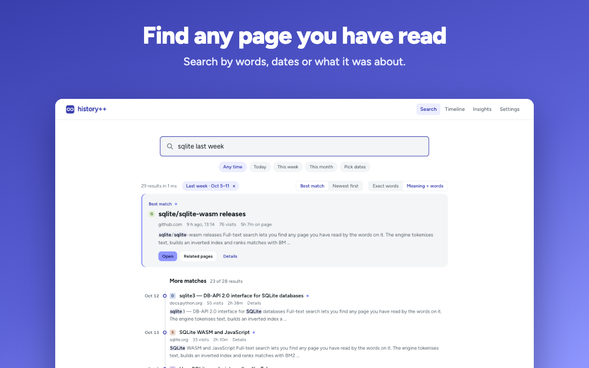
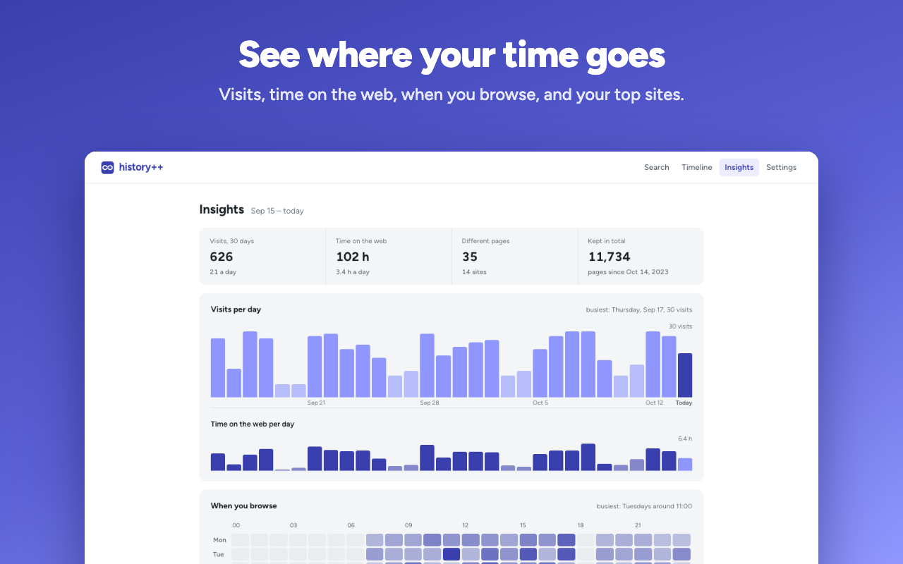
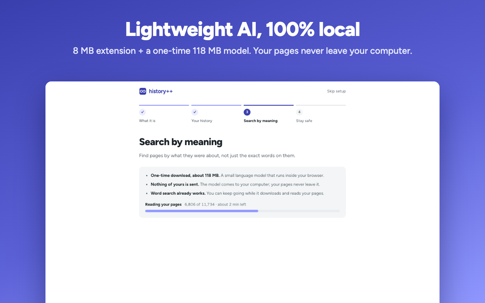

<p align="center"></p>

<h1 align="center">history++</h1>

<p align="center">Your browser deletes your history after 90 days and only remembers titles.<br>
history++ keeps every page you visit, with its text, on your own computer,<br>
and finds it again when you describe what it was about.</p>

<p align="center">
  <a href="https://chromewebstore.google.com/detail/pfkkahklejaflijcajbclbiagmlpngbf"></a>
  <a href="https://chromewebstore.google.com/detail/pfkkahklejaflijcajbclbiagmlpngbf"></a>
  <a href="LICENSE"></a>
</p>

<p align="center">
  <b><a href="https://chromewebstore.google.com/detail/pfkkahklejaflijcajbclbiagmlpngbf">Install for Chrome, Edge, Brave</a></b> ·
  <a href="docs/store/privacy-policy.md">Privacy</a> ·
  <a href="BUILD.md">Build from source</a>
</p>

<p align="center"><b>Plain-language search · Local AI (~120 MB model) · One SQLite file you own · Nothing leaves your computer</b></p>

<p align="center"></p>
<p align="center"></p>
<p align="center"></p>

## What it does

- **Search by meaning.** Type "that saas that collects user feedback" or "run AI models on my own laptop" and get the page, even when those words aren't in its title. Plain words, `site:`, and dates ("last week", "in September") work too.
- **Kept forever.** Every visit, plus the readable text of the pages you actually read. Your existing browser history is imported on install, and you can import history files from other browsers.
- **Many languages.** The search model is multilingual. Date words work in English and in Bosnian, Serbian and Croatian.
- **Timeline and insights.** Your days grouped into sessions; time on the web, top sites, sites you came back to.
- **Popup** (Alt+H): search, or reopen what you were just reading.
- **Backups you own.** A daily SQLite backup in your Downloads folder (the last 7 are kept). Restore from any of them, or export to JSON.

## Privacy

history++ has no servers, no account and no analytics. Your history, the pages you read and your searches never leave your computer.

- **Stored locally** in a SQLite database in the extension's private browser storage (OPFS).
- **One network request:** a one-time download of the search model (multilingual-e5-small, about 120 MB) from huggingface.co, only when you turn on search by meaning. It's pinned to a fixed commit and checked against SHA-256 hashes. The extension's CSP allows no other hosts.
- **Not recorded:** private windows; browser, local-network and `file:` pages; a built-in list of well-known banking, payment, email, sign-in and health sites; the text of any page with a password, one-time-code or card field (including card fields hosted by Stripe, Adyen and others); and any site on your own "never record" list. You can pause recording at any time.
- **Secrets in links** (password-reset and sign-in tokens, signed download links, `user:password@`) are removed before an address is saved.
- **Deleting is real:** forgetting a page or site overwrites it in the database file. Backups made before that still contain it until you delete them.
- **Backups aren't encrypted.** If your Downloads folder syncs to a cloud service, so do they. Turn daily backup off in Settings if you don't want that.

No built-in list knows every bank, so add the sites you care about to "never record". The full policy is in [PRIVACY.md](docs/store/privacy-policy.md).

### Why it needs these permissions

| Permission | Why |
|---|---|
| `history` | Import the history your browser already has, and catch up on visits made while the extension wasn't running. |
| All sites | Read the readable text of pages you stay on for a few seconds, so you can search inside them. |
| `tabs`, `webNavigation` | Know which page a visit belongs to, including in-page navigation on single-page sites; open results. |
| `storage`, `unlimitedStorage` | Settings, and a database that can grow past the default quota. |
| `downloads` | Write the daily backup and exports. |
| `alarms` | Schedule the catch-up and the backup. |
| `offscreen`, `favicon` (Chromium) | Run the database and search engine; show site icons from the browser's cache. |

## How search works

Each page's text is split into chunks and embedded on your device with [multilingual-e5-small](https://huggingface.co/Xenova/multilingual-e5-small) (onnxruntime-web, WebAssembly). A query is matched both by keywords (SQLite FTS5, BM25) and by meaning (cosine similarity over the chunk vectors), and the two rankings are merged. Dates in the query become filters before ranking.

On 58 labelled searches from real history, the right page came first **67%** of the time (in the top 5: 78%). A browser-style search (every word in the title or address, newest first) managed 24%. When you remember a page's exact title, both do fine; history++ is for when you don't. The eval harness is in [`scripts/eval`](scripts/eval); the labelled queries aren't published, because they come from real browsing.

## Limits

- Desktop only. Pages you read on your phone aren't captured.
- Imported history (from before install, or from other browsers) has addresses and titles, not page text.
- Search by meaning is slower to index on Firefox (single-threaded WebAssembly).
- The database grows with your browsing: page text is capped at 40,000 characters per page, and a few months of history is typically a few tens of MB.

## Browsers

Chrome, Edge, Brave and other Chromium browsers (Manifest V3): [install from the Chrome Web Store](https://chromewebstore.google.com/detail/pfkkahklejaflijcajbclbiagmlpngbf). A Firefox build exists (`npm run build:firefox`) but isn't on addons.mozilla.org yet.

## Build from source

```sh
npm ci
npm run build      # Chromium build in .output/chrome-mv3/
npm test
```

Load `.output/chrome-mv3` as an unpacked extension. Details, including notes for store reviewers, are in [BUILD.md](BUILD.md).

## Contributing

Bug reports and ideas are welcome in [issues](https://github.com/bendza/historyplusplus/issues). See [CONTRIBUTING.md](CONTRIBUTING.md) and the [roadmap](docs/roadmap.md).

## License

[MIT](LICENSE).
